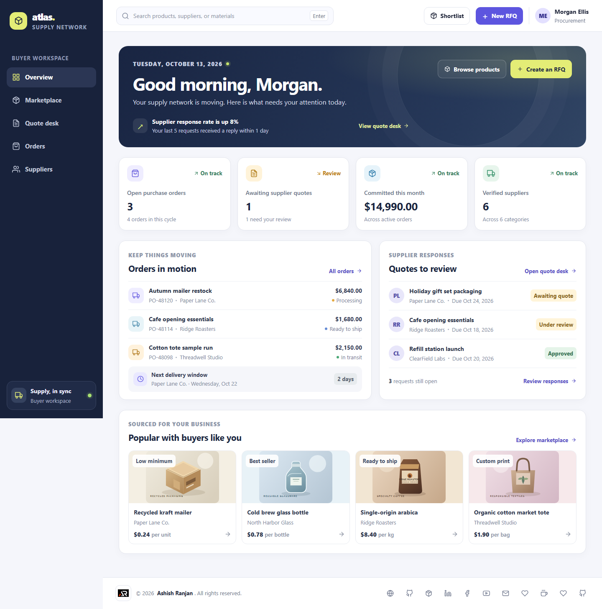

# Atlas Supply | Wholesale Marketplace

Atlas Supply is a frontend-only buyer workspace for sourcing wholesale products, comparing suppliers, requesting quotes, and tracking purchase orders.

**Live app:** [https://a2rp.github.io/b2b-wholesale-marketplace/](https://a2rp.github.io/b2b-wholesale-marketplace/)

## What you can do

- Browse the product catalog, search by product or supplier, filter by category, sort results, and keep a session-only shortlist.
- Review supplier profiles, search and sort the directory, filter verified suppliers, and follow suppliers during the session.
- Create and edit a quote request while it is awaiting a quote or under review. Validate its product, supplier, quantity, budget, response date, and notes.
- Search and filter the quote desk, inspect request details, update the request status, approve a request, and convert an approved request into a purchase order.
- Track purchase orders, inspect their details, advance their delivery stage, cancel an order with confirmation, and export order data.
- See overview totals update from the current quote and order records.

Visible actions provide feedback through custom dialogs and toasts. Destructive actions require confirmation. Demo changes are held in React state only and reset when the page is refreshed. The app does not connect to a backend or persist browser data.

## Pages

- `/overview` - Sourcing activity, quote and order summaries, and recommended products.
- `/marketplace` - Searchable wholesale product catalog with categories and product details.
- `/quotes` - Quote request workflow with review, status changes, editing, and conversion to orders.
- `/orders` - Purchase order register with delivery progress, detail views, cancellation, and export.
- `/suppliers` - Supplier directory, verification filters, follow controls, and profiles.

## Screenshots

These captures show the built app with representative sample data. Page captures include the desktop routes and a mobile marketplace view. Dialog captures show the product, quote, order, supplier, and confirmation states.

### Pages

#### Overview


#### Marketplace

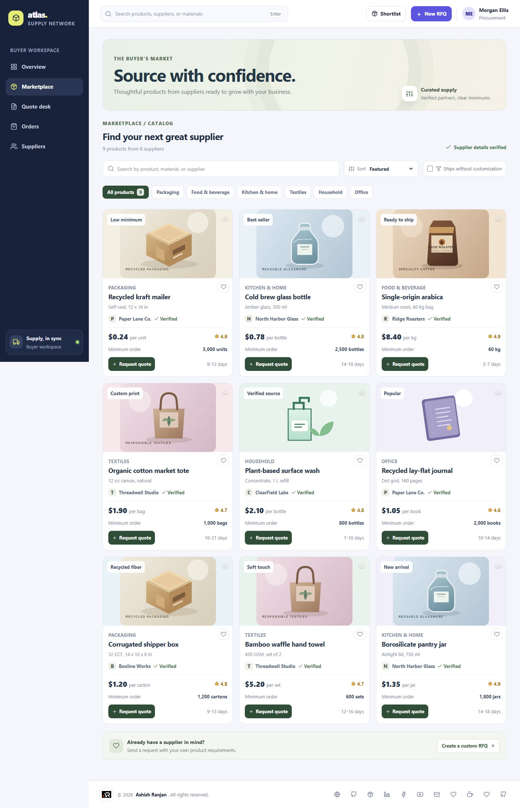

#### Quote desk

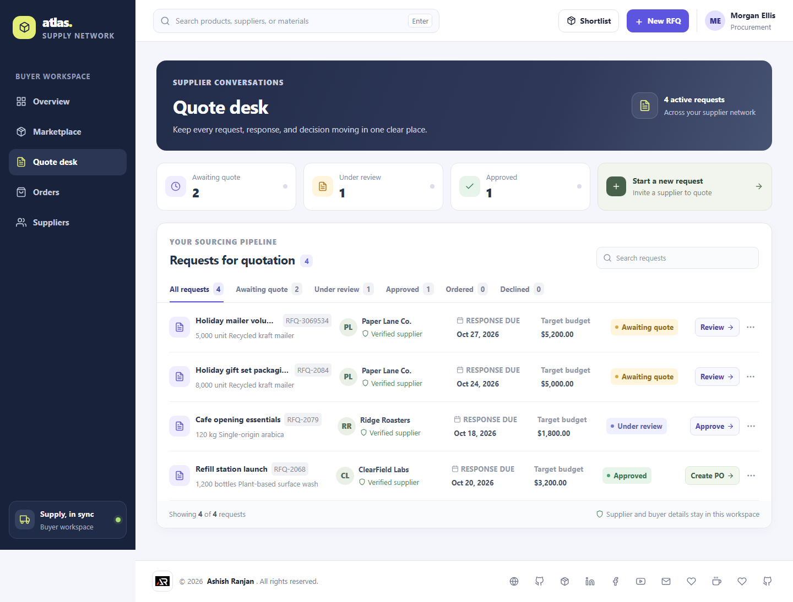

#### Purchase orders

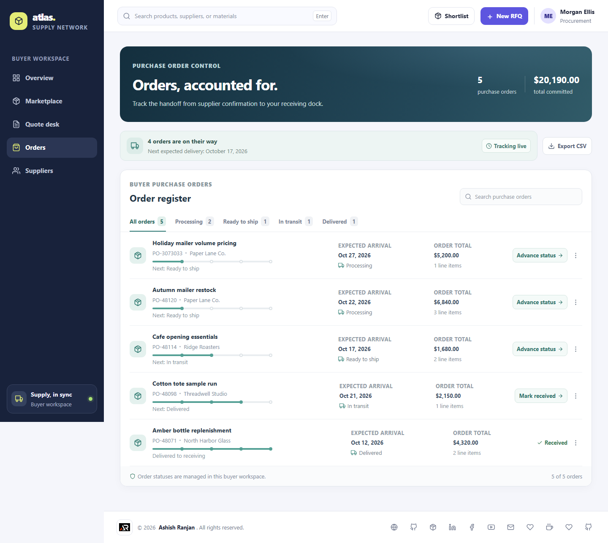

#### Supplier directory

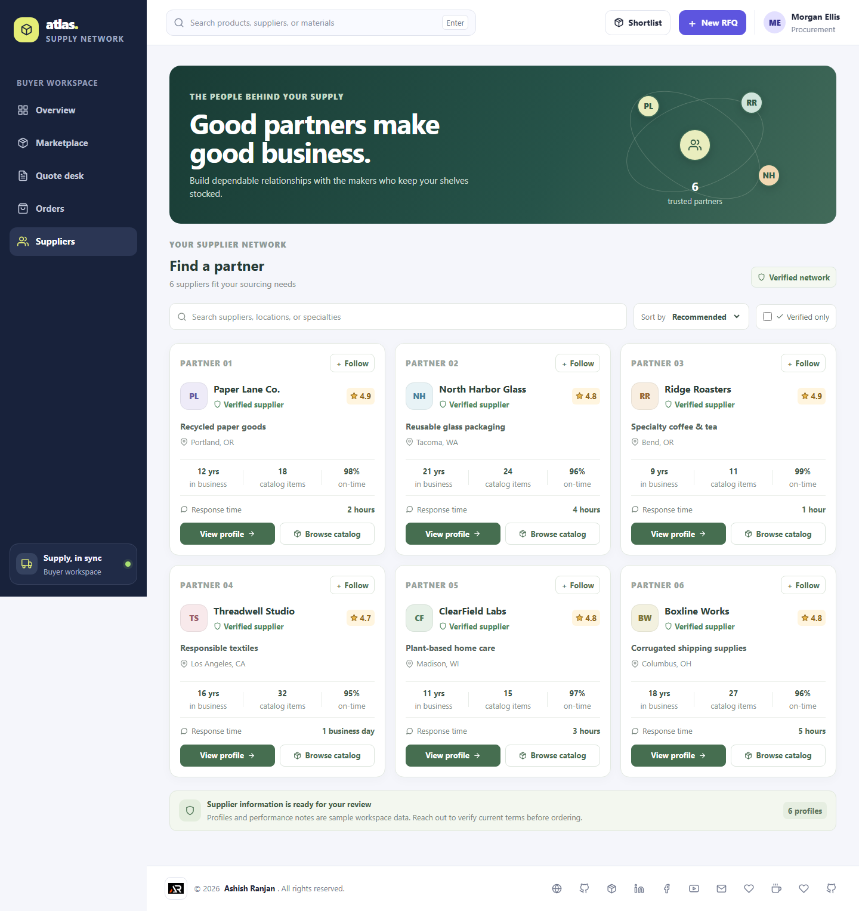

#### Marketplace on mobile

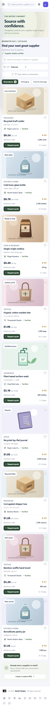

### Dialogs

#### Product details

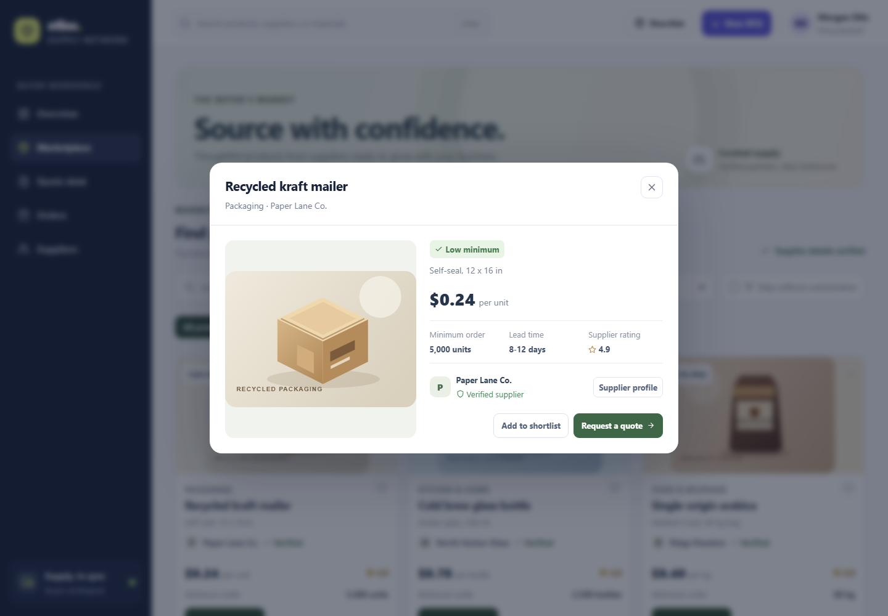

#### Create a quote request

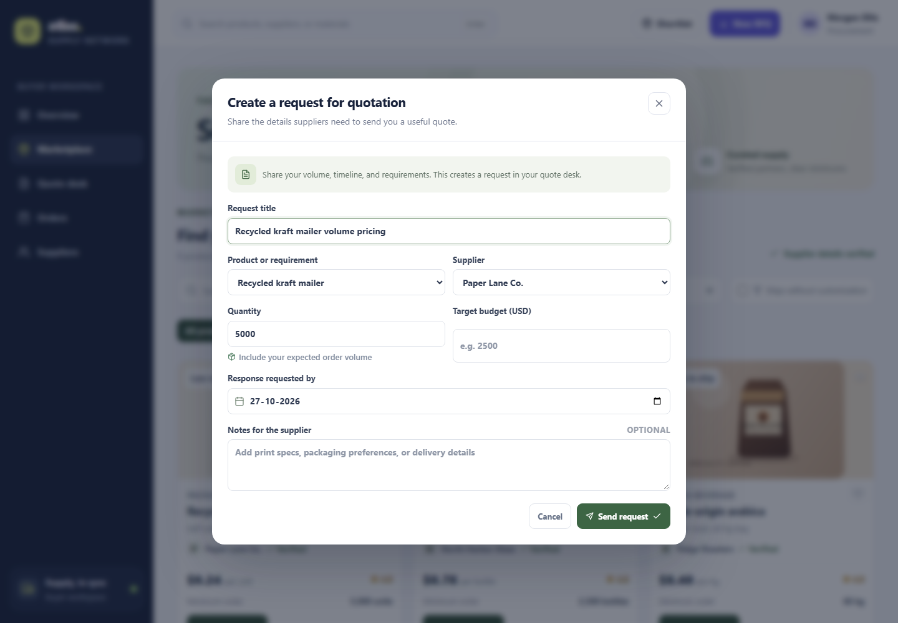

#### Quote request details

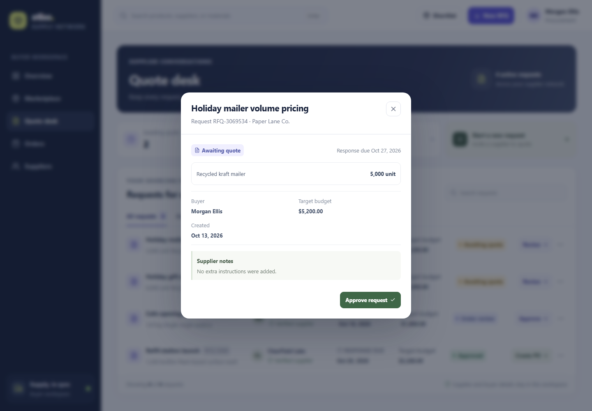

#### Edit a quote request

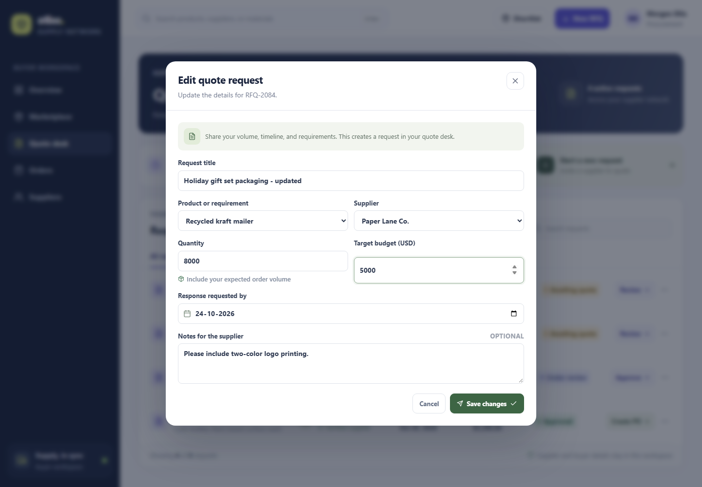

#### Remove request confirmation

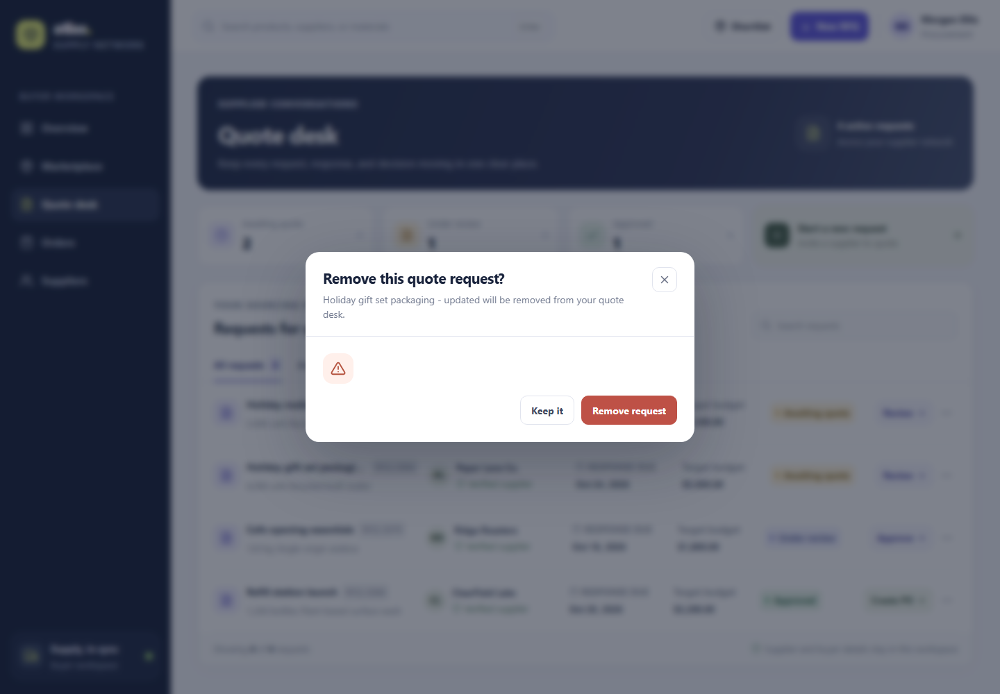

#### Purchase order details

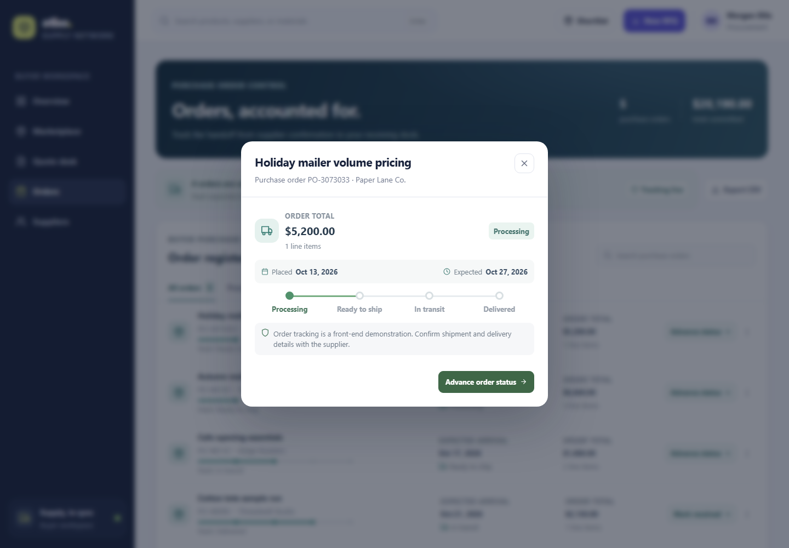

#### Cancel order confirmation

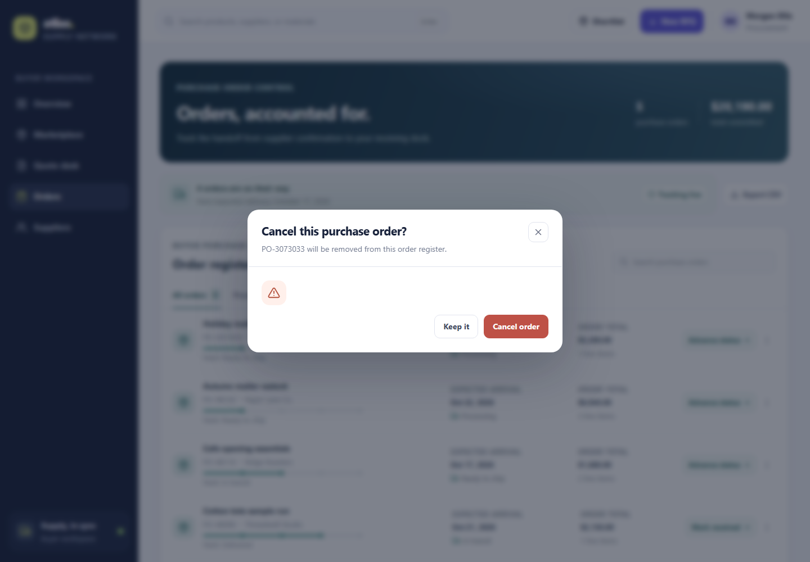

#### Supplier profile

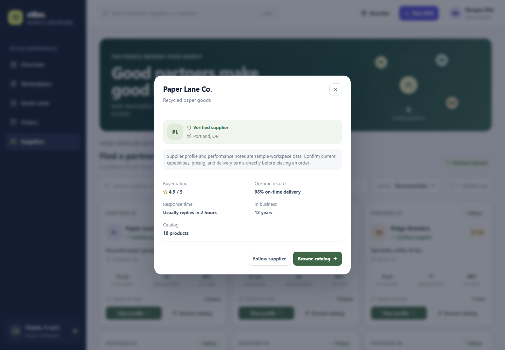

## Run locally

Requirements: Node.js and npm.

```sh
npm install
npm run dev
```

The app starts at the local URL shown by Vite. The repository uses React, Vite, React Router, React Icons, Motion, and OverlayScrollbars.

## Check and deploy

```sh
npm run lint
npm run build
npm run deploy
```

The deploy script builds the app, copies the entry page to the GitHub Pages fallback file, and publishes `dist` to the `gh-pages` branch. The project uses `BrowserRouter` with the `/b2b-wholesale-marketplace/` base path.

## Frontend demo limits

Product, supplier, quote, and order records are representative sample data. Actions update the current browser session only. The interface does not contact suppliers, validate live inventory or prices, submit payments, or send purchase orders. Confirm real commercial terms with suppliers outside this demo.

## Future improvements

These are backend or production extensions, not missing client-side workflows:

- Shared server storage, buyer and supplier accounts, and workspace permissions.
- Supplier integrations for live inventory, tiered pricing, order acknowledgements, and shipment updates.
- Secure hosted quote attachments, product documents, and compliance certificates.
- Server-side audit history and organization-level reporting across purchasing teams.

## Links

- Portfolio: [https://www.ashishranjan.net](https://www.ashishranjan.net)
- GitHub: [https://github.com/a2rp](https://github.com/a2rp)
- CodePen: [https://codepen.io/ash1198](https://codepen.io/ash1198)
- LinkedIn: [https://www.linkedin.com/in/aashishranjan](https://www.linkedin.com/in/aashishranjan)
- Facebook: [https://www.facebook.com/theash.ashish/](https://www.facebook.com/theash.ashish/)
- YouTube: [https://www.youtube.com/@ashishranjan-ashz?sub_confirmation=1](https://www.youtube.com/@ashishranjan-ashz?sub_confirmation=1)
- Email: [mailto:ash.ranjan09@gmail.com](mailto:ash.ranjan09@gmail.com)

## Support

- Support: [https://a2rp-donation-page.netlify.app/](https://a2rp-donation-page.netlify.app/)
- Buy Me a Coffee: [https://www.buymeacoffee.com/a2rp](https://www.buymeacoffee.com/a2rp)
